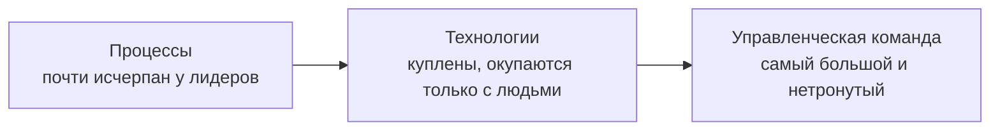

# СКОЛКОВО: обучение руководителей 2026 — «Точка пересборки»

## Коротко

Ежегодный опрос российских компаний о бизнес-приоритетах, состоянии управленческих команд и обучении руководителей. Сравниваются волны 2025 и 2026 годов.

Главный тезис исследования: внешние ограничения (ставка, спрос, санкции) у всех одинаковые, поэтому разница между компаниями в 2027 году будет в управленческой команде. Барьер роста сместился внутрь компании.

Для базы знаний это внешнее подтверждение диагноза метода [[Personal/Context|«Право управлять»]]: руководитель управляет из позиции прошлого уровня, а прежняя модель перестала работать.

## Самое важное для моей базы знаний

### 1. Ограничение роста — управление, а не рынок

Главное ограничение роста в 2027 году (множественный выбор):

| Причина | Доля |
|---|---|
| Экономический спад и падение доходов клиентов | 44% |
| Неспособность руководителей выйти за рамки старых моделей мышления | 37% |
| Дефицит сильных руководителей и преемников | 21% |
| Неспособность перестроить бизнес-модель | 19% |
| Падение производительности из-за перегрузки и выгорания | 16% |
| Дорогой капитал и ограниченность инвестиций | 15% |
| Слишком медленное внедрение ИИ и автоматизации | 11% |

- Хотя бы одну управленческую причину назвали **65%** (187 человек), экономический спад — 44% (127 человек). Пересечение: 135 — только управление, 52 — оба варианта, 75 — только спад.
- Вывод исследования: управленческие причины называют в полтора раза чаще.

### 2. Три резерва эффективности

- Процессы: бережливое производство, нормирование, регламенты. Освоены лучше всего, отдача снижается.
- Технологии: ИИ, автоматизация, цифровые двойники. Окупаются там, где люди меняют способ работы.
- Управленческая команда: способность выйти из старых моделей и работать в новом режиме.

### 3. Повестка: эффективность и пересмотр стратегии

| Бизнес-приоритет 2026–2027 | 2025 → 2026 |
|---|---|
| Операционная эффективность | 49% → 62% (+13) |
| Финансовая устойчивость | — → 39% (новое) |
| Пересмотр стратегии | 24% → 37% (+13) |
| Продажи / новые ниши | 34% → 28% (−6) |
| ИИ- и цифровая трансформация | 27% → 28% (+1) |
| Удержание ключевых людей | 24% → 22% (−2) |
| Организационная трансформация | 26% → 17% (−9) |
| Развитие корпоративной культуры | 28% → 11% (−17) |

### 4. Рынок труда: не нанимают, а перераспределяют работу

| HR-приоритет | 2025 → 2026 |
|---|---|
| Производительность труда | 61% → 54% (−7) |
| Перераспределение функций* | 19% → 44% (+25) |
| Мотивация и вовлеченность* | 32% → 39% (+7) |
| Сохранение ключевых сотрудников | 56% → 23% (−33) |
| Обучение сотрудников* | 30% → 22% (−8) |
| Сокращение сотрудников | 5% → 14% (+9) |
| Найм новых сотрудников | 18% → 8% (−10) |

\* В источнике подписи этих строк помечены как плохо читаемые на фото.

### 5. Состояние управленческих команд

**69%** команд назвали хотя бы одно состояние из группы напряжения (множественный выбор):

| Группа | Состояние | Доля |
|---|---|---|
| Напряжение | Усталость: работа на пределе, команда выгорает | 34% |
| Напряжение | Пересборка: старая модель не работает, строим новую | 28% |
| Напряжение | Фрагментация: нет единого языка и картины будущего | 26% |
| Напряжение | Нужны новые смыслы: запрос на изменения, но нет понимания как | 20% |
| Мобилизация | Работа на пределе, но есть драйв и общая цель | 22% |
| Спокойствие | Приподнятое настроение, планомерная работа | 13% |
| Спокойствие | Стабильность, работа в обычном режиме | 13% |

Только 6% выбрали состояния из обеих групп.

Метафора исследования: смена контекста «от героев к борцам». Герой делает рывок и получает награду, борец держит дистанцию без гарантии награды.

### 6. Чему учить руководителя

| Группа | Топ-5 компетенций (изменение, п.п.) |
|---|---|
| Hard skills | Операционная эффективность 42% (−1); стратегия и бизнес-модель 39% (−7); решения в неопределенности 39% (+14); ИИ-агенты и вайбкодинг 38% (новое); управление изменениями 37% (−12) |
| Soft skills | Кросс-функциональное взаимодействие 41% (н/д); коммуникация 37% (−6); гибридные команды из людей и ИИ-агентов 30% (новое); управление конфликтами 27% (−3); делегирование и распределение ответственности 26% (±0) |
| Self skills | Психологическая устойчивость 43% (+21); умение учиться и переучиваться 37% (+25); управление собой 32% (+5); целеполагание 30% (−2); решение проблем 30% (−1) |

Формула запроса 2026 года по версии исследования: работать с неопределенностью, с ИИ, на стыках между командами и выдерживать это долгое время.

Цели обучения сместились: управленческая грамотность 42% → 32%, личностный рост 33% → 23%, цифровые компетенции 18% → 25%, новые идеи для бизнеса 24% → 30%. Базовый менеджмент считают закрытым. По выводу исследования, за обучением идут скорее за сменой состояния и связями, чем за знаниями.

### 7. Бюджеты, места и форматы обучения

- Расходы на обучение руководителей сократили **35%**: урезали затраты (22%) или кратно уменьшили бюджет (14%); итог дан в источнике. Нарастили — **9%** против 22% годом раньше. Не строят планы на год вперед — 31%.
- Где учат топов: внутри компании или в корпоративном университете — 60% → 50%, смешанная модель «внутри + партнер» — 34%, онлайн — 31% → 20%. Не планируют обучать руководителей — 7% → 15%.
- Длительность: больше коротких интенсивов на 2–5 дней — 34%, отталкиваются от целей, а не от длительности — 23%, постоянная поддержка эксперта или коуча — 17%, больше программ от нескольких месяцев — **8%**.
- Форматы: стратегические сессии 65% → 46%, корпоративные программы 49% → 37%, открытые программы 38% → 27%, коучинг 30% → 25%, менторство 23% → 24%, ИИ-помощник — 27% (новое), работа команд с бизнес-трекерами — 18% (новое).

### 8. Смена единицы ценности

| Раньше покупали вход | Теперь покупают выход |
|---|---|
| Программа и модули | Решенная бизнес-задача |
| Дни в классе | Изменение, заметное через 3–6 месяцев |
| Известные спикеры | Команда, которая работает иначе |
| Развитие «вдолгую», сертификат | Рабочий результат: решение, модель, продукт |

**50%** считают обучение на реальных бизнес-задачах главным трендом на 3–5 лет.

### 9. Роль руководителя, когда ИИ заберет аналитику

| Главный источник ценности руководителя в 2027 году | Доля |
|---|---|
| Сложные решения в неопределенности и ответственность за них | 41% |
| Стратегия и видение будущего | 36% |
| Сильная команда и среда доверия | 31% |
| Интеграция людей, ИИ и процессов в единую систему | 26% |
| Жизнестойкие системы и новая бизнес-модель | 18% |
| Развитие людей и преемников | 10% |
| Экспертная глубина в своей функции | 8% |
| Объяснение смыслами и нарративами | 4% |

Наблюдение исследования: в верхних позициях то, что нельзя делегировать машине, — ответственность, направление, доверие. При этом в другом вопросе за гибкость голосуют 45%: один и тот же человек отвечает на два вопроса по-разному.

## Практическая интерпретация

Интерпретация, а не утверждения исследования.

- **Для метода «Право управлять».** Слова «рамки старых моделей мышления» (37%) почти совпадают с диагнозом «управляет из позиции предыдущего уровня». Ответственность за решения (41%) против функциональной экспертизы (8%) — довод в пользу того, что переход EM → Director упирается в позицию, а не в знания.
- **Для продуктов.** Сдвиг «от входа к выходу» подтверждает работу на ситуации этой недели и итог «Трезвого взгляда» на одной странице. Длинные программы планируют только 8%, поэтому программу от трех месяцев лучше продавать через результат, а не через срок.
- **Для второго клиента (первое лицо).** Перераспределение функций выросло с 19% до 44%, найм упал: руководителям дают больше работы без новых людей и мандатов. Отсюда реорганизации и формальные титулы без команды.
- **Для каналов продаж.** Корпоративные бюджеты в России сжимаются (35% против 9%), поэтому опора на руководителя, который платит сам, надежнее B2B-продаж в российский корпоративный сектор.
- **Для позиций метода.** Усталость 34% — среда для позиции «Герой». Кросс-функциональное взаимодействие (41%) — это «Проситель» и влияние без прямой власти. Рост решений в неопределенности (+14) и умения переучиваться (+25) — это «Наблюдатель» и долгие сомнения.
- **Для линии advisory.** Тезис «технологии куплены, окупаются только с людьми» и новые строки про ИИ-агентов (38%) и гибридные команды (30%) подходят для работы по AI-трансформации. Личный бренд с этим не смешивать.
- **Чего не брать.** Метафору «от героев к борцам»: в методе выход из позиции «Героя» ведет к системе и мандату, а не к выносливости. Рамку «смена субъекта — КТО?»: это авторская подача СКОЛКОВО.

## Диагностические вопросы

- Что ограничивает рост вашей компании — рынок или то, как команда принимает решения?
- Какую работу за год переложили на ваших руководителей без новых людей и мандатов?
- В каком состоянии ваша управленческая команда: усталость, пересборка, фрагментация или мобилизация?
- Какие решения в компании по-прежнему держатся на функциональной экспертизе руководителя, а не на его ответственности?
- Какой результат развития руководителей вы увидите через 3–6 месяцев, а не в сертификате?

## Материал для постов автора

Только факты для автора: тексты постов агент не пишет.

- 65% против 44%: барьер роста внутри компании, а не на рынке.
- Экспертиза в функции — 8% среди источников ценности руководителя, ответственность за решения — 41%.
- Найм 18% → 8%, перераспределение функций 19% → 44%.
- 69% управленческих команд в напряжении, усталость — 34%.

## Оговорки

- Выборка — российские компании, которые планируют обучение руководителей. Размер выборки в слайдах не указан; по пересчету долей со слайда 5 (187 человек = 65%) — около 290 респондентов. Переносить выводы на рынки США, ЕС, Израиля и ОАЭ напрямую нельзя.
- Файл — реконструкция слайдов выступления по фотографиям, а не оригинальный отчет. Подписи трех строк на слайде 7 помечены как требующие сверки с оригиналом.
- Вопросы с множественным выбором: доли не складываются в 100%.
- Некоторые строки появились только в волне 2026 года, сравнение по ним невозможно.

## Связанные заметки

- [[Personal/Context|Позиционирование и метод «Право управлять»]]
- [[Frameworks/models/decision-systems|Системы принятия решений]]
- [[Frameworks/models/organizational-operating-model|Организационная операционная модель]]
- [[Frameworks/models/systemic-management|Системное управление]]
- [[Frameworks/models/ai-native-organization|AI-native organization]]
- [[Frameworks/source-notes/mit-nanda-genai-divide-state-of-ai-in-business-2025|MIT NANDA GenAI Divide 2025]]

## Источник

- PDF: `Frameworks/sources/leadership-development/skolkovo-executive-learning-2026.pdf`
- Исследование: «Чему будут учиться руководители российских компаний?», Школа управления СКОЛКОВО, волны 2025 и 2026. Выступление Дениса Конанчука, директора по корпоративному обучению, на «Фронтир практики».
- 16 слайдов; слайды 7 и 8 сверены по изображению страниц.
