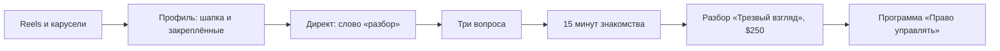

# План Instagram на 90 дней

Связи:
- [[Personal/Context|Позиционирование и метод]]
- [[Personal/BRAND|BRAND.md — бренд]]
- [[Personal/marketing/instagram-profile|Профиль в Instagram]] — шапка, Актуальное, визуальная система, директ
- [[Personal/marketing/brand-launch-checklist|Чеклист запуска]]

Черновик 2026-11-14. Все цифры — гипотезы: клиентов из Instagram пока не было.

## Задача

Проверить за 12 недель, продаёт ли Instagram разбор «Трезвый взгляд» холодной аудитории. Это один из трёх пунктов чеклиста, которые проверяются только практикой.

**Цель на 90 дней:** 5 оплаченных разборов из Instagram, один переход в программу.

**Решение 14 февраля 2027:**
- 3 и больше разборов или 15 и больше содержательных обращений в директ — продолжаем, увеличиваем ритм.
- Меньше — Instagram остаётся витриной, основное время уходит в getmentor, LinkedIn и рекомендации.

## Главный риск

Новый экспертный аккаунт без подписчиков почти никто не видит. Хороший контент без источников трафика даст ноль. Поэтому половина плана — откуда придут первые 500 человек, а не что публиковать.

Второй риск: в России Instagram работает через VPN. Ядро аудитории здесь — руководители, которые переехали или пользуются VPN по привычке. Тех, кто сидит только в Telegram, ловит канал «Управление и Счастье», поэтому лучшие посты дублируются туда.

## Воронка

Дополнительный вход — слово «позиции» в директ: в ответ приходит самопроверка «Из какой позиции вы управляете» на одну страницу. Она даёт повод написать тем, кто ещё не готов платить.

## Этапы

| Этап | Даты | Что происходит | Признак, что этап пройден |
|---|---|---|---|
| 0. Запуск | 16–22 ноября | Шапка, Актуальное, 6 постов в сетке, быстрые ответы. Аккаунт не анонсируется, пока сетка пустая | Посетитель за 10 секунд понимает, кто это и что делать |
| 1. Узнавание | 23 ноября — 20 декабря | По неделе на позицию: герой, проситель, лояльный солдат, хороший парень | Сохранения и пересылки, первые сообщения в директ |
| 2. Пауза на праздники | 21 декабря — 10 января | 1 пост в неделю, сторис. Тема — решения, которые переносятся на следующий год | Не теряем ритм |
| 3. Продажа | 11 января — 14 февраля | Январь — время карьерных решений. Прямое предложение разбора раз в неделю, публичные разборы, кейсы | Разборы оплачены |

## Ритм

Три поста в неделю и сторис четыре дня из семи.

| День | Формат | Зачем |
|---|---|---|
| Понедельник | Reels 30–60 секунд, Владимир в кадре | Охват: Instagram показывает новым людям в основном видео |
| Среда | Карусель 6–8 слайдов | Сохранения и пересылки, глубина |
| Пятница | Тезис, кейс или голос клиента | Доверие и сетка |
| Сторис | Опрос, ответ на вопрос, кусок с встречи без деталей клиента | Тёплая аудитория пишет в директ из сторис |

**Время Владимира — 4–5 часов в неделю.**
- Съёмка Reels раз в две недели, 1,5 часа на 6 роликов по готовым тезисам.
- Сторис — 10 минут в день.
- Директ и знакомства — по мере обращений.
- Остальное — тексты, слайды, обложки и календарь — делает агент.

## Рубрики

Доли — от числа постов за месяц.

| Рубрика | Доля | Что внутри | Шаблон из визуальной системы |
|---|---|---|---|
| Позиции | 30% | Как проявляется, во что обходится, один неудобный шаг | Карусель |
| Был на вашем месте | 20% | Свои истории: рост с 80 до 500, собеседование на CTO в 2017-м, два закрытых бизнеса | Reels, тезис |
| Инструмент | 20% | PAEI, уровни делегирования, формула влияния — под одну ситуацию | Карусель |
| Было — стало | 15% | Три обезличенных кейса, отзывы с сайта | Кейс, голос клиента |
| Публичный разбор | 10% | Ситуация, присланная в директ, без узнаваемых деталей и с согласия | Карусель |
| Предложение | 5% + сторис | Разбор «Трезвый взгляд»: для кого, что получаете, цена, как записаться | Тёмная плитка |

Публичный разбор — главный механизм продажи: чтобы прислать ситуацию, человек пишет в директ, и с этого начинается разговор.

## Первые пять недель

Темы взяты из фраз и слоганов `BRAND.md`. Тексты готовятся в `/Posts`.

**Неделя 0, запуск — 6 постов в сетке**
1. Кто это и почему его слушать — закреплён.
2. Из какой позиции вы управляете — карусель на пять позиций, закреплён.
3. Разбор «Трезвый взгляд» — закреплён.
4. Тезис: «Право управлять не выдают вместе с должностью».
5. Голос клиента: Ольга.
6. Кейс: реорганизация стояла 12 месяцев → должность Director.

**Неделя 1 — герой**
- Reels: «"Так быстрее" — самая дорогая фраза руководителя».
- Карусель: сколько часов в неделю стоит «сделаю сам» — час в неделю и десять часов.
- Тезис: «Без вас всё встаёт, значит, вы не управляете».

**Неделя 2 — проситель**
- Reels: «Перестаньте просить. Задайте рамку».
- Карусель: формула влияния «мандат → позиция → последствия → бизнес-польза».
- Голос клиента: Антон.

**Неделя 3 — лояльный солдат**
- Reels: «Лояльность — не карьерная стратегия».
- Карусель: «Следующую роль не дают. Её берут» — как присвоить сделанный результат.
- Кейс: повышение до исполнительного директора за год.
- Первое прямое предложение разбора в сторис.

**Неделя 4 — хороший парень**
- Reels: «Как говорите — так и управляете».
- Карусель: уровни делегирования.
- Призыв прислать свою ситуацию для публичного разбора.

Дальше — наблюдатель, свои провалы, публичные разборы и январская серия про решения, которые откладываются. План на недели 5–12 собирается после первых четырёх недель по тому, что сохраняют и о чём пишут.

## Откуда придут первые подписчики

| Источник | Действие | Когда |
|---|---|---|
| Личная база | Личное сообщение 50+ бывшим менти и коллегам: ссылка на карусель о позициях с просьбой переслать тому, кому она про него. Не «подпишитесь» | Неделя 1 |
| Telegram «Управление и Счастье» | Анонс аккаунта, дальше лучшие карусели дублируются в канал со ссылкой | Неделя 1, затем еженедельно |
| LinkedIn | Ссылка в профиле; посты про позиции подходят и для LinkedIn | Неделя 1 |
| getmentor и сайт | Ссылка на Instagram в описании профиля и в подвале сайта | Неделя 1 |
| Выступления | QR-код на последнем слайде, слово «позиции» в директ | Каждое выступление |
| Совместные посты и эфиры | Один в месяц: HR-сообщества, карьерные консультанты, подкасты про управление. Список кандидатов собирает агент | С недели 3 |
| Комментарии | 15 минут в день содержательных комментариев в аккаунтах, где сидит та же аудитория | Ежедневно |
| Продвижение | Тест $100–150 на карусель о позициях, если органический охват ниже 500 за пост | Неделя 5, по решению Владимира |

## Учёт

Раз в неделю, в воскресенье, 15 минут. Таблица ведётся здесь же.

| Неделя | Подписчики | Охват за неделю | Сохранения + пересылки | Обращения в директ | Знакомства | Разборы | Что повторить |
|---|---|---|---|---|---|---|---|
| 0 | | | | | | | |

Обращение считается содержательным, если человек ответил на три вопроса.

## Кто что делает

**Агент:**
- тексты и слайды трёх закреплённых постов и обложек Актуального — первым делом;
- самопроверка «Из какой позиции вы управляете» на одну страницу;
- тезисы для Reels пачкой по шесть;
- карусели по неделям и список кандидатов для совместных постов;
- еженедельный разбор цифр и план на следующую неделю.

**Владимир:**
- занять имя пользователя и заполнить профиль;
- съёмка Reels раз в две недели, сторис, директ, знакомства;
- сообщения личной базе и анонс в Telegram;
- решение о платном продвижении на неделе 5.
