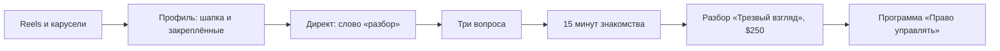

# План Instagram на 90 дней

Связи:
- [[Personal/Context|Позиционирование и метод]]
- [[Personal/BRAND|BRAND.md — бренд]]
- [[Personal/marketing/instagram-profile|Профиль в Instagram]] — шапка, Актуальное, визуальная система, директ
- [[Personal/marketing/brand-launch-checklist|Чеклист запуска]]

Черновик 2026-11-14. Все цифры — гипотезы: клиентов из Instagram пока не было.

## Задача

Проверить за 12 недель, продаёт ли Instagram разбор «Трезвый взгляд» холодной аудитории. Это один из трёх пунктов чеклиста, которые проверяются только практикой.

**Цель на 90 дней:** 5 оплаченных разборов из Instagram, один переход в программу.

**Решение 14 февраля 2027:**
- 3 и больше разборов или 15 и больше содержательных обращений в директ — продолжаем, увеличиваем ритм.
- Меньше — Instagram остаётся витриной, основное время уходит в getmentor, LinkedIn и рекомендации.

## Главный риск

Новый экспертный аккаунт без подписчиков почти никто не видит. Хороший контент без источников трафика даст ноль. Поэтому половина плана — откуда придут первые 500 человек, а не что публиковать.

Второй риск: в России Instagram работает через VPN. Ядро аудитории здесь — руководители, которые переехали или пользуются VPN по привычке. Тех, кто сидит только в Telegram, ловит канал «Управление и Счастье», поэтому лучшие посты дублируются туда.

## Воронка

Дополнительный вход — слово «позиции» в директ: в ответ приходит самопроверка «Из какой позиции вы управляете» на одну страницу. Она даёт повод написать тем, кто ещё не готов платить.

## Этапы

| Этап | Даты | Что происходит | Признак, что этап пройден |
|---|---|---|---|
| 0. Запуск | 16–22 ноября | Шапка, Актуальное, 6 постов в сетке, быстрые ответы. Аккаунт не анонсируется, пока сетка пустая | Посетитель за 10 секунд понимает, кто это и что делать |
| 1. Узнавание | 23 ноября — 20 декабря | По неделе на позицию: герой, проситель, лояльный солдат, хороший парень | Сохранения и пересылки, первые сообщения в директ |
| 2. Пауза на праздники | 21 декабря — 10 января | 2 Reels и 1 карусель в неделю, сторис. Тема — решения, которые переносятся на следующий год | Не теряем ритм |
| 3. Продажа | 11 января — 14 февраля | Январь — время карьерных решений. Прямое предложение разбора раз в неделю, публичные разборы, кейсы | Разборы оплачены |

## Ритм

Решение Владимира 2026-11-14: пять Reels в неделю. Новых людей аккаунту без подписчиков приводят почти только Reels, а 60 роликов за тест дают выборку, по которой видно, какие крючки работают. Семь в неделю не берём: съёмка не укладывается в одну сессию, а в выходные аудитория листает меньше.

| Формат | Сколько | Зачем |
|---|---|---|
| Reels 20–40 секунд, Владимир в кадре, субтитры | 5 в неделю, по будням | Охват новых людей |
| Карусель 6–8 слайдов или кейс | 2 в неделю, вторник и четверг | Сохранения, пересылки, продажа тем, кто уже пришёл |
| Сторис: опрос, ответ на вопрос, предложение разбора | 4–5 дней в неделю, включая выходные | Тёплая аудитория пишет в директ из сторис |

**Один Reels — одна мысль.** Крючок в первые две секунды — фраза, в которой руководитель узнаёт себя. Затем факт или своя история. В конце — один шаг или слово в директ.

**Производство.**
- Агент пишет пять сценариев на неделю: крючок, 3–4 фразы, призыв.
- Владимир снимает пять роликов за одну сессию, около 2 часов, раз в неделю.
- Монтаж — нейросеть: вырезка пауз, субтитры, обложка из шаблона визуальной системы. Субтитры набором Onest, одно ключевое слово красным.
- Агент готовит карусели и подписи к роликам.

**Время Владимира — 6–7 часов в неделю:** съёмка 2 часа, проверка смонтированных роликов 30 минут, сторис 10 минут в день, директ и знакомства — по мере обращений.

**Проверка через три недели, 13 декабря.**
- Медиана просмотров Reels ниже 300 — проблема в крючках и первых двух секундах. Меняем подачу, а не добавляем ролики.
- Просмотры есть, а в директ не пишут — проблема в профиле и предложении.
- Сохраняют и пишут — держим ритм.

## Рубрики

Доли — от числа публикаций за месяц, Reels и каруселей вместе.

| Рубрика | Доля | Что внутри | Шаблон из визуальной системы |
|---|---|---|---|
| Позиции | 30% | Как проявляется, во что обходится, один неудобный шаг | Reels, карусель |
| Был на вашем месте | 20% | Свои истории: рост с 80 до 500, собеседование на CTO в 2017-м, два закрытых бизнеса | Reels |
| Инструмент | 20% | PAEI, уровни делегирования, формула влияния — под одну ситуацию | Карусель |
| Было — стало | 15% | Три обезличенных кейса, отзывы с сайта | Кейс, голос клиента |
| Публичный разбор | 10% | Ситуация, присланная в директ, без узнаваемых деталей и с согласия | Карусель |
| Предложение | 5% + сторис | Разбор «Трезвый взгляд»: для кого, что получаете, цена, как записаться | Тёмная плитка |

Публичный разбор — главный механизм продажи: чтобы прислать ситуацию, человек пишет в директ, и с этого начинается разговор.

## Первые пять недель

Темы взяты из фраз и слоганов `BRAND.md`. Сценарии Reels и тексты каруселей готовятся в `/Posts`.

**Неделя 0, 16–22 ноября — запуск**
- Сетка до анонса, 6 постов: три закреплённых (кто я, пять позиций, разбор «Трезвый взгляд»), тезис «Право управлять не выдают вместе с должностью», голос клиента — Ольга, кейс — реорганизация стояла 12 месяцев, затем должность Director.
- Reels, 3: «Кто я за 30 секунд — и почему начинать надо с провала»; «Пять позиций, из которых руководители управляют не своим уровнем»; «Руководитель застревает не из-за нехватки знаний».

**Неделя 1 — герой**
- Reels:
  1. «"Так быстрее" — самая дорогая фраза руководителя».
  2. «Без вас всё встаёт, значит, вы не управляете».
  3. «Час в неделю — и фиг с ним. Десять часов — нифига себе»: посчитайте, сколько стоит «сделаю сам».
  4. Своя история: рост с 80 до 500 человек и момент, когда перестал успевать сам.
  5. «Героя не повышают: его некем заменить».
- Карусели: сколько часов в неделю стоит «сделаю сам»; уровни делегирования.

**Неделя 2 — проситель**
- Reels:
  1. «Перестаньте просить. Задайте рамку».
  2. Одна фраза в двух версиях: как звучит просьба и как звучит рамка.
  3. «Смежники не слушают: у вас нет мандата или вы им не пользуетесь?»
  4. Своя история о влиянии на смежников без прямой власти.
  5. Ответ на вопрос из директа или опроса в сторис.
- Карусели: формула влияния «мандат → позиция → последствия → бизнес-польза»; кейс — техлиды перешли к управлению 3–4 командами каждый.

**Неделя 3 — лояльный солдат**
- Reels:
  1. «Лояльность — не карьерная стратегия».
  2. «Следующую роль не дают. Её берут».
  3. «Сделали правильно, но никто не знает»: присвоение результата.
  4. Своя история: собеседование на CTO в биг-техе в 2017 году, которое не прошёл.
  5. Предложение: что такое разбор «Трезвый взгляд» и как записаться — 30 секунд.
- Карусели: как собрать результат в историю для начальника; кейс — повышение до исполнительного директора за год.

**Неделя 4 — хороший парень**
- Reels:
  1. «Как говорите — так и управляете».
  2. Мягкая формулировка растушёвывает цель: одна фраза до и после.
  3. «Люди сели на шею — и это не про них».
  4. Страх выглядеть манипулятором.
  5. Призыв прислать свою ситуацию для публичного разбора.
- Карусели: обратная связь без растушёвки; голос клиента — Антон: доверие команды без потери требовательности.

Дальше — наблюдатель, свои провалы, публичные разборы и январская серия про решения, которые откладываются. План на недели 5–12 собирается после проверки 13 декабря по тому, какие ролики смотрят до конца, сохраняют и после каких пишут.

## Откуда придут первые подписчики

| Источник | Действие | Когда |
|---|---|---|
| Личная база | Личное сообщение 50+ бывшим менти и коллегам: ссылка на карусель о позициях с просьбой переслать тому, кому она про него. Не «подпишитесь» | Неделя 1 |
| Telegram «Управление и Счастье» | Анонс аккаунта, дальше лучшие карусели дублируются в канал со ссылкой | Неделя 1, затем еженедельно |
| LinkedIn | Ссылка в профиле; посты про позиции подходят и для LinkedIn | Неделя 1 |
| getmentor и сайт | Ссылка на Instagram в описании профиля и в подвале сайта | Неделя 1 |
| Выступления | QR-код на последнем слайде, слово «позиции» в директ | Каждое выступление |
| Совместные посты и эфиры | Один в месяц: HR-сообщества, карьерные консультанты, подкасты про управление. Список кандидатов собирает агент | С недели 3 |
| Комментарии | 15 минут в день содержательных комментариев в аккаунтах, где сидит та же аудитория | Ежедневно |
| Продвижение | Тест $100–150 на карусель о позициях, если органический охват ниже 500 за пост | Неделя 5, по решению Владимира |

## Учёт

Раз в неделю, в воскресенье, 15 минут. Таблица ведётся здесь же.

| Неделя | Подписчики | Охват за неделю | Медиана просмотров Reels | Лучший Reels | Сохранения + пересылки | Обращения в директ | Знакомства | Разборы |
|---|---|---|---|---|---|---|---|---|
| 0 | | | | | | | | |

Обращение считается содержательным, если человек ответил на три вопроса.

## Кто что делает

**Агент:**
- тексты и слайды трёх закреплённых постов и обложек Актуального — первым делом;
- самопроверка «Из какой позиции вы управляете» на одну страницу;
- пять сценариев Reels на неделю, за день до съёмки;
- карусели по неделям и список кандидатов для совместных постов;
- еженедельный разбор цифр и план на следующую неделю.

**Владимир:**
- занять имя пользователя и заполнить профиль;
- съёмка пяти Reels раз в неделю, проверка монтажа, сторис, директ, знакомства;
- сообщения личной базе и анонс в Telegram;
- решение о платном продвижении на неделе 5.
