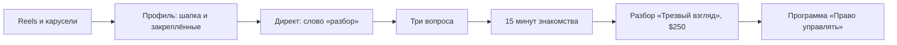

# Контент-план

Что выкладываем: ритм, недели, цель, учёт, производство. Расписание по дням с текстами и картинками — в файлах недель, ссылки ниже. Включает бывший «План Instagram на 90 дней». Главнее него только [[Posts/AGENTS|Posts/AGENTS.md]] (кто пишет тексты) и [[Personal/Context|Personal/Context.md]] (позиционирование).

Как читать таблицы:
- ✅ — текст и файлы лежат, можно публиковать.
- ❌ — чего-то не хватает: в ячейке подсвечено ==НЕ ХВАТАЕТ: что именно==, над таблицей недели — сводка. Тексты пишет автор, агент — сценарии Reels из тезисов автора, рендер и проверки.
- Картинки показаны прямо в таблице; видео лежат вне vault, `~/Movies/reels-N-final.mp4`.
- LinkedIn и Telegram — одна строка: Telegram дублирует LinkedIn, тот же текст в тот же день. Нет поста LinkedIn — день в обоих пропускается.
- Время — московское (МСК, UTC+3) во всём контент-плане. Колонка «Время» — момент, когда Buffer публикует пост, формат `09:00`. С недели 2 Instagram, Threads и LinkedIn публикуются через Buffer: агент ставит пост ровно на это время. Пустая ячейка — время по таблице «Ритм»; своё время вписывается только для исключений. Telegram — тоже автоматически: агент ставит пост в отложенные сообщения канала скриптом `Posts/render/tg.py` (от аккаунта автора, без сервера).
- Сторис — 4–5 дней в неделю, включая выходные: опрос, ответ на вопрос, предложение разбора. В таблицы не вносятся.

Картинки недели — в её папке: `Posts/weeks/<дата>/instagram/img/`, `linkedin/img/`, PDF-карусели — в `linkedin/`. Скрипты и тексты слайдов — общие, в `Posts/render/`. Готовые ролики — `~/Movies/reels-N-final.mp4`. Тексты публикаций — в файле своей недели.

## Ритм

| Канал | Что | Когда | Время, МСК |
|---|---|---|---|
| Instagram | Reels | Пн–пт | 09:00 |
| Instagram | Карусель или тезис-картинка | Вт и чт | 18:00 |
| Threads | Пост или цепочка по Reels дня | В день Reels | 12:00 |
| LinkedIn, Telegram | Пост по Reels дня | В день Reels | 10:00 |

**Threads.** До 500 знаков на пост, цепочка — ответами на первый. Пересказ ролика не работает — одна мысль. Охват дают ответы; ссылки на Instagram и «разбор» — в ответе или в профиле, не в каждом посте.

**Пауза, 28 декабря — 10 января:** 2 Reels и 1 карусель в неделю, посты остальных каналов — в дни Reels.

## Недели

Одна неделя — один файл `_index.md` в папке недели: таблица публикаций по дням и каналам, тексты, картинки, отметки «не хватает».

| Неделя | Даты и тема | Статус |
|---|---|---|
| 0 | [[Posts/weeks/2026-11-16-launch/_index\|16–22 ноября — запуск]] | Опубликовано, есть хвосты |
| 1 | [[Posts/weeks/2026-11-23-week-1/_index\|23–29 ноября — серия «Почему повысят не вас»]] | Всё готово |
| 2 | [[Posts/weeks/2026-11-30-week-2/_index\|30 ноября — 6 декабря — герой]] | Снять 5 Reels, тексты |
| 3 | [[Posts/weeks/2026-12-07-week-3/_index\|7–13 декабря — проситель]] | Снять 5 Reels, тексты |
| 4 | [[Posts/weeks/2026-12-14-week-4/_index\|14–20 декабря — лояльный солдат]] | Снять 5 Reels, тексты |
| 5 | [[Posts/weeks/2026-12-21-week-5/_index\|21–27 декабря — хороший парень]] | Снять 5 Reels + 2 недели 6, тексты |
| 6 | [[Posts/weeks/2026-12-28-week-6/_index\|28 декабря — 3 января — пауза, итог серии позиций]] | Снять 2 Reels, тексты |

## Недели 7–12, 4 января — 14 февраля

Собираются после проверки 13 декабря — по тому, какие ролики смотрят до конца, сохраняют и после каких пишут. Темы-кандидаты: наблюдатель, свои провалы, публичные разборы, январская серия про решения, которые откладываются. С 11 января — продажа: прямое предложение разбора раз в неделю, публичные разборы, кейсы.

---

## Задача

Проверить за 12 недель, продаёт ли Instagram разбор «Трезвый взгляд» холодной аудитории. Все цифры — гипотезы: клиентов из Instagram пока не было.

**Цель на 90 дней:** 5 оплаченных разборов из Instagram, один переход в программу.

**Решение 14 февраля 2027:** 3 и больше разборов или 15 и больше содержательных обращений в директ — продолжаем, увеличиваем ритм. Меньше — Instagram остаётся витриной, время уходит в getmentor, LinkedIn и рекомендации.

**Риски.** Новый аккаунт без подписчиков почти никто не видит: без источников трафика контент даст ноль. В России Instagram работает через VPN; тех, кто сидит только в Telegram, ловит канал «Управление и Счастье».



Дополнительный вход — слово «позиции» в директ: в ответ приходит самопроверка «Из какой позиции вы управляете» на одну страницу.

## Откуда придут первые подписчики

| Источник | Действие | Когда |
|---|---|---|
| Личная база | Личное сообщение 50+ бывшим менти и коллегам: ссылка на карусель о позициях с просьбой переслать тому, кому она про него. Не «подпишитесь» | Неделя 1 |
| Telegram «Управление и Счастье» | Анонс аккаунта, дальше канал дублирует LinkedIn | Неделя 1 |
| LinkedIn | Ссылка в профиле | Неделя 1 |
| getmentor и сайт | Ссылка на Instagram в описании профиля и в подвале сайта | Неделя 1 |
| Выступления | QR-код на последнем слайде, слово «позиции» в директ | Каждое выступление |
| Совместные посты и эфиры | Один в месяц: HR-сообщества, карьерные консультанты, подкасты про управление. Список кандидатов собирает агент | С недели 3 |
| Комментарии | 15 минут в день содержательных комментариев в аккаунтах той же аудитории | Ежедневно |
| Продвижение | Тест $100–150 на карусель о позициях, если органический охват ниже 500 за пост | Неделя 5, по решению Владимира |

## Учёт

Раз в неделю, в воскресенье, 15 минут.

| Неделя | Подписчики | Охват за неделю | Медиана просмотров Reels | Лучший Reels | Сохранения + пересылки | Обращения в директ | Знакомства | Разборы |
|---|---|---|---|---|---|---|---|---|
| 0 | | | | | | | | |

Обращение считается содержательным, если человек ответил на три вопроса.

## Рубрики

Доли — от числа публикаций в Instagram за месяц.

| Рубрика | Доля | Что внутри |
|---|---|---|
| Позиции | 30% | Как проявляется, во что обходится, один неудобный шаг |
| Был на вашем месте | 20% | Свои истории: рост с 80 до 500, собеседование на CTO в 2017-м, два закрытых бизнеса |
| Инструмент | 20% | PAEI, уровни делегирования, формула влияния — под одну ситуацию |
| Было — стало | 15% | Три обезличенных кейса, отзывы с сайта и отзыв Engineering Manager из LinkedIn |
| Публичный разбор | 10% | Ситуация, присланная в директ, без узнаваемых деталей и с согласия — главный механизм продажи |
| Предложение | 5% + сторис | Разбор «Трезвый взгляд»: для кого, что получаете, цена, как записаться |

## Кто что делает и время

**Владимир:** тексты постов, каруселей и подписей, тезисы для Reels; съёмка пяти Reels за одну сессию раз в неделю, около 2 часов; проверка монтажа, сторис, директ, знакомства; учёт в воскресенье; решение о продвижении на неделе 5. Время на контент — до одного дня в неделю, пока клиентов мало — больше (решение 2026-11-20).

**Агент:** сценарии Reels из тезисов автора, монтаж скриптом `Posts/render/reel.py`, рендер слайдов и обложек `Posts/render/render.py`, проверки по запросу, самопроверка «Из какой позиции вы управляете», список кандидатов для совместных постов, план следующей недели по цифрам Владимира.

**Один Reels — одна мысль.** Крючок в первые две секунды — фраза, в которой руководитель узнаёт себя. Затем факт или своя история. В конце — один шаг или слово в директ.

## Производство

### Как снимать

- **Кадр.** Вертикально 9:16, по грудь, лицо в верхней трети. Спокойный фон: стена или доска, без книжных полок напоказ.
- **Свет.** Окно или лампа сбоку-спереди. Звук — петличка или наушники с микрофоном у рта.
- **Подача.** Говорить в камеру, как собеседнику на встрече: спокойно, без улыбки на крючке. Текст — ориентир, не читать дословно.
- **Первые две секунды.** Крючок произносится сразу, без «привет» и вдоха. Если дубль начался с паузы — нейросеть её вырежет, но лучше переснять.
- **Цвет.** Естественный, приглушённый, без фильтров и яркой цветокоррекции. Ч/б остаётся только для фото на сайте и в профиле: в видео он съедает мимику и делает ролик «эстетикой», а не разговором (решение 2026-11-15). Узнаваемость в ленте дают субтитры, красное слово — единственный яркий акцент в кадре.

### Монтаж

- Вырезать паузы и оговорки.
- Субтитры: Onest, полужирный, 2–4 слова на экран, тёмная плашка `#16181A` и светлый текст `#F3F4F1`. Одно ключевое слово на ролик — красным `#D2302C`.
- Без музыки или с тихим фоном. Без эмодзи, переходов и зума на каждой фразе.
- Обложка — готовая картинка из `instagram/img/`, смысловая зона по центру, в сетке Instagram обрежет до 4:5.

Скрипт `Posts/render/reel.py` делает всё из списка выше, кроме обложки: режет паузы, выравнивает звук до −15 LUFS, вжигает субтитры. Обложка ставится в Instagram при публикации: «Изменить обложку» → «Добавить из галереи».

Один раз — окружение, из корня KnowledgeOS:

```bash
python3 -m venv Posts/render/.venv && Posts/render/.venv/bin/pip install imageio-ffmpeg faster-whisper pillow
```

На каждый ролик:

1. Распознать речь. Рядом с видео появится папка `<имя>.reel/` с `captions.txt`.

```bash
Posts/render/.venv/bin/python Posts/render/reel.py prep ~/Movies/take.mov
```

2. Поправить `captions.txt`: ошибки распознавания (имена, mos.ru, EdTech), разбивку на экраны, красное слово в `*звёздочках*`. Формат описан в начале `reel.py`.
3. Собрать ролик.

```bash
Posts/render/.venv/bin/python Posts/render/reel.py render ~/Movies/take.mov ~/Movies/reels-2-final.mp4
```

Правила, найденные на Reels 1:

- Запас на склейке — 0,16 с до фразы и 0,26 с после. Меньше — речь звучит рубленой.
- Экран субтитров — до 20 знаков. Длинное слово («технического», «руководителям») идёт отдельным экраном.
- Перед фразой — полсекунды тишины. Петличка глушит тишину и открывается с опозданием, первый звук срезается («с тех пор»). Вытянуть его на монтаже не получается: звучит неестественно.
- Красных слов — одно-два: ключевое в крючке и слово-призыв «разбор» в конце.

- Цвет (Reels 2): камера в комнатном свете приподнимает чёрное и уводит его в синий, картинка выходит белёсой и мыльной. `render` по умолчанию снимает дымку, чуть добавляет контраст и резкость (`GRADE` в `reel.py`); отключить — `--grade none`. Лучше лечить на съёмке: больше света на лицо, запись 4K/30 вместо 1080p/60.
- Несколько дублей в одной записи: выбрать лучший по `words.json` и передать в `render` участки исходника через `--keep 59.5-82.5,91.8-110.6`. Если нужного дубля нет в `words.json` (распознавание пропускает повторы), дописать его слова в конец файла.

Рабочие файлы Reels 1: `~/Movies/good.reel/`, готовый ролик: `~/Movies/reels-1-final.mp4`.
- Много дублей подряд (Reels 3): распознавание по всей записи сдвигает таймкоды и пропускает повторы. Надёжнее распознать каждый участок из `speech.json` отдельно, выбрать дубли, дописать их слова в `words.json` и выровнять начала фраз по `speech.json`.
- Кадр для обложки брать из исходника с той же коррекцией, что и ролик, плюс немного насыщенности и резкости: `-vf "colorlevels=gimin=0.03:bimin=0.075,eq=contrast=1.08:saturation=1.08,unsharp=5:5:1.0:5:5:0"`. Без неё кадр мутный, чёрное синее.
- Перед записью проверить индикатор звука: первый дубль Reels 3 записался без звука.

Рабочие файлы Reels 2: `~/Movies/2026-11-19 10-56-09.reel/` (исходник переименован в `r2 - draft.mov`, при сборке нужен `--work`), готовый ролик: `~/Movies/reels-2-final.mp4`.
Рабочие файлы Reels 3: `~/Movies/r3 - draft.reel/` (выбор дублей и `--keep` — в начале `captions.txt`), готовый ролик: `~/Movies/reels-3-final.mp4`, 61 с.
Рабочие файлы Reels 4: `~/Movies/r4 - draft.reel/` (дубли расписаны в начале `captions.txt`), готовый ролик: `~/Movies/reels-4-final.mp4`. Сборка:

```bash
Posts/render/.venv/bin/python Posts/render/reel.py render "$HOME/Movies/r4 - draft.mov" ~/Movies/reels-4-final.mp4 --keep 32.4-35.9,36.3-38.2,52.9-55.8,60.54-70.3,101.0-108.6,137.94-144.3,179.7-187.5,211.7-219.0 \
  --grade "colorlevels=gimin=0.03:bimin=0.075,eq=contrast=1.06:saturation=1.12,unsharp=5:5:0.9:5:5:0"
```

Цвет Reels 4 насыщеннее и резче стандартного `GRADE` (решение автора, 2026-11-19): насыщенность +12%, резкость 0,9 вместо 0,7. Кадр обложки `frames/r4-49s.jpg` вынут с той же коррекцией.

Рабочие файлы Reels 5: `~/Movies/reels-5-final.reel/` (дубли и `--keep` — в начале `captions.txt`), исходник — `~/Movies/reels-5-final.mov` (сырая запись, 5 мин, несмотря на имя), готовый ролик: `~/Movies/reels-5-final.mp4`, 71 с. `~/Movies/r5-draft.mp4` — копия готового Reels 3 с вшитыми субтитрами, не исходник. Сборка:

```bash
Posts/render/.venv/bin/python Posts/render/reel.py render ~/Movies/reels-5-final.mov ~/Movies/reels-5-final.mp4 --keep 22.0-24.6,40.2-52.2,78.3-83.3,84.8-88.2,102.8-106.0,113.0-123.1,127.9-133.4,143.7-153.0,163.3-168.0,175.8-179.0,182.7-188.0,227.6-230.9,283.7-290.0
```

### Рендер картинок

Instagram, из корня KnowledgeOS:

```bash
python3 Posts/render/render.py Posts/render/slides/instagram.py
```

LinkedIn, вместе с PDF-каруселями:

```bash
Posts/render/.venv/bin/python Posts/render/render.py Posts/render/slides/linkedin.py
```

Тексты слайдов — в `Posts/render/slides/<канал>.py`, у каждого слайда поле `week`: рендер кладёт картинку в папку этой недели. Вторым аргументом можно передать префикс имени, чтобы перерисовать не всё, например `r-kurs`. Сводный лист для проверки — во временной папке, путь печатается в конце. Подпись на слайдах LinkedIn — «Владимир Семенюк · semenyuk.pro», без ника Instagram. В LinkedIn карусель загружается как документ: «+» → «Документ» → PDF. Сторис Актуального: опубликовать по порядку, затем «Добавить в Актуальное» → новый кружок, обложка — файл `-0` из галереи.
