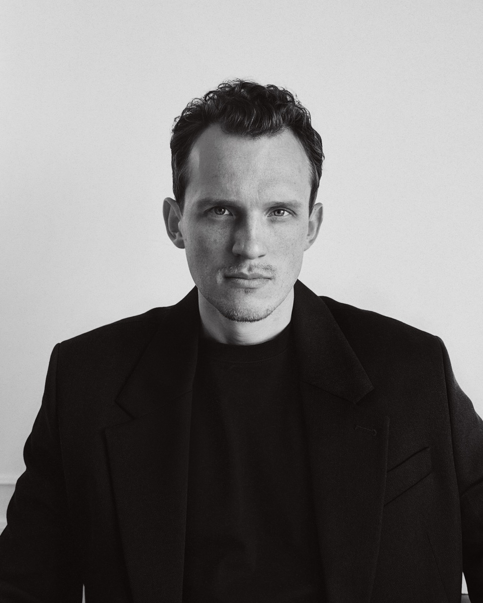
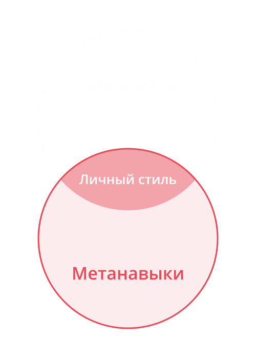
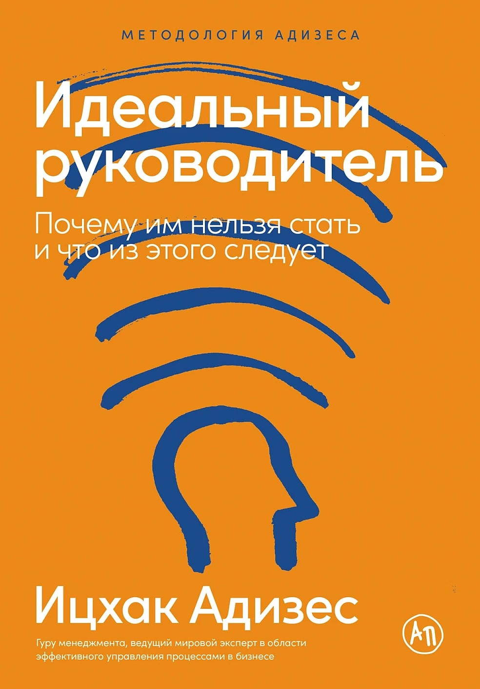
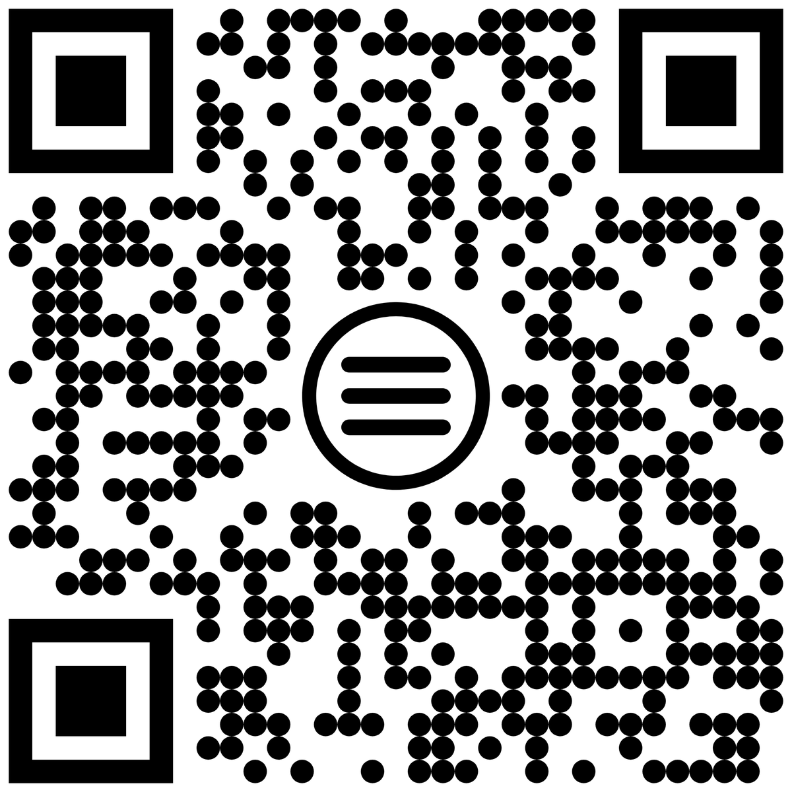

<!-- _class: lead -->
<!-- _paginate: false -->

# Востребованность менеджера в кризис: метанавыки и личный стиль управления

Владимир Семенюк

<!--
Старт. 30 минут, из них 6 на вопросы.
-->

---

## Кто я

- 17 лет в управлении технологиями: 
  ex-CTO Нетологии.
- Собственный бизнес: ML-стартап, теннисный клуб и школа в Белграде.
- Сейчас — консалтинг и менторство.

<!--
≈20 сек. Быстро, без подробностей. Теннисный клуб — сквозная история доклада, на нём акцент.
-->

---

> Кризис: как раньше — уже не работает,
> а по‑новому — пока не умею

- Меня повысили / меня не повысили
- Меня уволили / не могу найти работу
- Не уверен в своей профессиональной ценности
- Не знаю, что мне нравится, а то, чем занимаюсь, — не нравится
- В новой области или роли мой опыт не срабатывает

<!--
≈1,5 мин. В индустрии кризис, это пугает. Но по сути он мало отличается от кризисов, которые каждый уже проживал: старые опоры исчезли, новые ещё не сформировались.

Перечень — быстро и бережно, дать узнать себя. Последний пункт — мой случай, от него переход к истории клуба.
-->

---

## Что происходит, когда стараемся ещё сильнее

**Реакция опытного менеджера:** усилить свой привычный способ — кто‑то закручивает гайки, а я ещё больше доверял

**Теннисный клуб:**
- Управлял тренерами и админами как IT‑специалистами: автономия, доверие, ожидание инициативы
- Получил расхлябанность и рост инцидентов — например, опозданий
- Первая реакция — «дожать» прежним способом: объяснять, доверять, ждать инициативы

> Больше усилий в старом способе не возвращает результат

<!--
≈1,5 мин. [уточнить — что конкретно делал, когда «дожимал»]. Вывод: нужно пересматривать сам способ, а не давить сильнее.
-->

---

<!-- _class: lead -->

## Где искать новую опору?

Можно — в совершенно новом.
Легче — **перенести то, что уже есть**, и адаптировать.

<!--
≈30 сек. Переход к блоку 2 (4:00).
-->

---

<!-- _class: tight -->

## Дистанция переноса

| Что переносится                                               | Продавец → художник                                                        | IT → теннисный клуб                                                                                       |
| ------------------------------------------------------------- | -------------------------------------------------------------------------- | --------------------------------------------------------------------------------------------------------- |
| **Знания отрасли** — почти не переносятся                     | Знание товара и каналов не помогает писать картины                         | Представление об IT‑бизнесе и мотивации IT‑специалистов не помогло: клуб ближе к салону красоты, чем к IT |
| **Профнавыки** — с адаптацией, в близких задачах              | Умение продавать помогает продавать картины                                | Найм, адаптация, проекты, бюджеты. ITSM‑инциденты → обращения клиентов с SLA/SLO на ответы админов        |
| **Метанавыки** — между далёкими областями, если их осознавать | Обучение на обратной связи, саморегуляция: режим, отказы                   | Системное мышление: опоздания и жалобы — симптом системы, нужен процесс. Обратная связь: менять стандарты по метрикам |
| **Склонности** — переносятся вместе с вами                     | Тот, кто любит доводить продажу до финала, и в живописи дописывает картины | Сильная роль **A** из IT: стандарты, процессы, контроль исполнения                                        |

<!--
≈3 мин. Начало блока 2, сразу после «Где искать новую опору?» (≈4:00). Чем дальше новая область, тем хуже переносится опыт.
Подавать как наблюдение из своего опыта: перенос срабатывает, когда навык осознан.
Метанавык подсказал, ЧТО нужно (процесс вместо разовых реакций), навык — КАК (адаптированный ITSM).
Склонности — через какие роли это сделать (сильная A). Подробнее — на слайде про Адизеса.
Если не укладываемся — колонку «продавец → художник» одной фразой.
-->

---
## Личный стиль

**Склонности** — управленческие роли, которые вам естественны: что вы делаете охотно и хорошо. Они переходят вместе с вами

**Метанавыки** — способности, которые переносятся между областями

<!--
≈30 сек (≈7:00). Два понятия, которые разберём дальше: сначала склонности, затем метанавыки.
Это разные вещи, и развиваются они по-разному. На их пересечении — ваш личный стиль.
-->

---

## Склонности по Адизесу: идеального руководителя нет

| Роль                             | Что делает                      | Мой профиль     |
| -------------------------------- | ------------------------------- | --------------- |
| **P** — производитель результата | Доводит до результата           | p — слабее      |
| **A** — администратор            | Стандарты, регламенты, контроль | **A — сильная** |
| **E** — предприниматель          | Видит возможности, меняет       | **E — сильная** |
| **I** — интегратор               | Объединяет людей                | **I — сильная** |

Один человек не силён во всех ролях → **понимать себя и дополнять другими**

<!--
≈1 мин на модель PAEI, затем переход к своему профилю pAEI.
-->

---

## Как понять свои склонности

1. Какие управленческие роли мне естественны, а какие я **избегаю**?
2. Где **дополнить себя другими людьми**?

Где исследовать свои склонности: **Ицхак Адизес**, «Идеальный руководитель. Почему им нельзя стать и что из этого следует»

<!--
≈1 мин. Дать паузу на вопросах, затем книга. Дальше — метанавыки (≈9:30).
-->

---

<!-- _class: skills compact -->

## Метанавыки и как их развивать

| Метанавык | Проявление | Инструменты |
|---|---|---|
| **Ответственность за результат** | Прояснять цель, принимать обязательства, проверять результат | RACI, OKR |
| **Системное мышление** | Видеть связи, ограничения и причины повторяющихся проблем | Balanced Scorecard, диаграмма причинно-следственных связей |
| **Обучение на обратной связи** | Сопоставлять ожидания с результатом и пересматривать подход | Разбор после действия (AAR), журнал решений, метрики |
| **Творческое мышление** | Находить другие способы достичь цели | Переформулирование задачи, SCAMPER |
| **Критическое мышление** | Проверять основания выводов, отличать факты от предположений | Карта аргументов, журнал предположений |
| **Работа с неопределённостью** | Принимать соразмерные риску решения при неполной информации | Сценарное планирование, карточка эксперимента |
| **Понимание разных перспектив** | Учитывать цели, интересы и ограничения других людей | Карта заинтересованных сторон, структурированное интервью |
| **Саморегуляция** | Замечать своё состояние и осознанно выбирать действие | Дневник реакций, пауза перед ответом |

<!--
≈3 мин (≈9:30). Голосом раскрываю первые четыре — только проявление, без примеров. Остальные четыре — только на слайде.
Ответственность связана с полномочиями и договорённостями, а не с готовностью отвечать за всё.
Инструменты — проговорить 1–2 пары: RACI → ответственность за результат; Balanced Scorecard → системное мышление. Инструмент — конкретный способ применить метанавык в задаче.
Дальше — как развивать метанавык (≈12:30).
-->

---

## Инструмент ≠ способность

Инструмент помогает **применить** метанавык в конкретной задаче.

Но владение инструментом ещё не значит, что способность развита.

> RACI заполнена, а за решение по‑прежнему никто не отвечает

Способность растёт, когда инструмент применяют **на реальном кейсе** и сверяют с результатом

<!--
≈30 сек (≈12:30). Инструменты только что были на слайде — но сами по себе они ничего не развивают. Нужен цикл.
-->

---

## Цикл развития

**Кейс** → **метанавык**, который помогает с ним справиться → 
**формальный инструмент** → **применение** → **обратная связь** → повтор ↺

<!--
≈1,5 мин. Пройти цикл по шагам. Неважно, откуда обратная связь — от человека или по метрикам. Важно, чтобы она была.
-->

---

## Разбор: теннисный клуб

| Шаг            | Что было                                                                                   |
| -------------- | ------------------------------------------------------------------------------------------ |
| **Кейс**       | Опоздания и инциденты, недовольство клиентов                                               |
| **Метанавык**  | Системное мышление + обучение на обратной связи                                            |
| **Инструмент** | Система обращений по ITSM, SLA/SLO на ответы админов, стандарты и чек-листы, анализ метрик |
| **Результат**  | Лучший клиентский сервис по отзывам, удержанию и сравнению с конкурентами                  |

<!--
≈3 мин. Кейс и метанавык зал уже знает — проходим быстро, акцент на результате и честном финале.
Честный финал: клуб закрылся — разочаровался в бизнес-модели. Но сервис был лучшим, и этот опыт остался со мной.
-->

---

## Первый шаг

1. Выберите **кейс**
2. Найдите **метанавык**, который помогает с ним справиться
3. Подберите **формальный инструмент** и примените его
4. Получите **обратную связь** по результату
5. Повторяйте до вашего удовлетворения

<!--
≈1,5 мин. Финал содержательной части (≈19:00). Не торопиться, дать сфотографировать слайд.
Замкнуть на начало: «Как раньше — уже не работает. Но по-новому вы научитесь быстрее, потому что опираетесь на то, что у вас уже есть: метанавыки и свои склонности. Это и есть ваша востребованность».
-->

---

<!-- _class: lead contacts -->
<!-- _paginate: false -->

# Вопросы

**Владимир Семенюк**

- Email: [vladimir@semenyuk.pro](mailto:vladimir@semenyuk.pro)
- Telegram: [@vladimirsemenyuk](https://t.me/vladimirsemenyuk)
- Канал «Управление и Счастье»: [t.me/management_and_happiness](https://t.me/management_and_happiness)
- Threads: [@vladimir.semenyuk](https://www.threads.com/@vladimir.semenyuk)
- LinkedIn: [in/vladimir-semenyuk](https://www.linkedin.com/in/vladimir-semenyuk/)

<!--
6 минут. Заготовки:
- Как выбрать, какой метанавык развивать первым?
- Как отличить свои склонности от избегания неприятных задач?
- Что делать, если в компании не принято давать обратную связь?
- Можно ли понять свои склонности без книги Адизеса?
- Если сервис был лучшим, почему клуб закрылся? [заготовить: развести операционную эффективность и бизнес-модель]
-->
