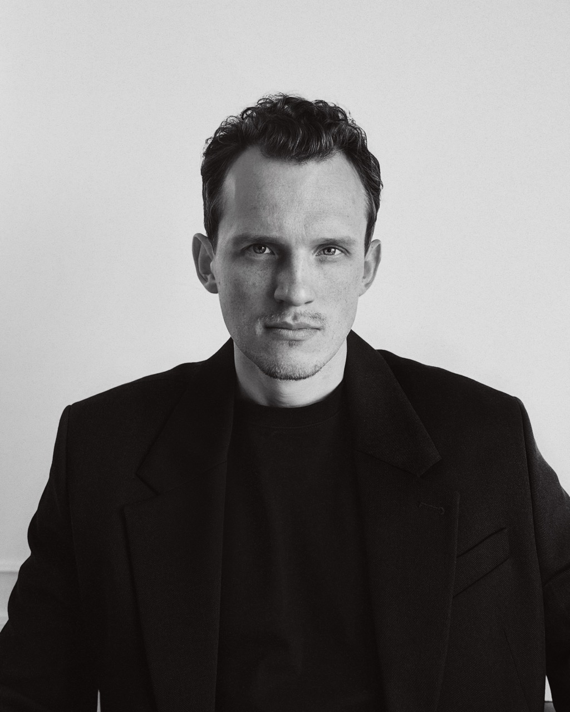

<!-- _class: lead -->
<!-- _paginate: false -->

# Метанавыки и инструменты

### Владимир Семенюк 
*Стратегический советник, ментор, IT‑предприниматель*

---

## Мышление

| Метанавык                      | Проявление                                                   | Инструменты                                                  |
| ------------------------------ | ------------------------------------------------------------ | ------------------------------------------------------------ |
| **Системное мышление**         | Видеть связи, ограничения и причины повторяющихся проблем    | Диаграмма причинных петель; стратегическая карта BSC         |
| **Критическое мышление**       | Проверять основания выводов, отличать факты от предположений | Карта аргументов; журнал допущений                           |
| **Творческое мышление**        | Находить другие способы достичь цели                         | SCAMPER; переформулирование задачи                           |
| **Структурирование**           | Раскладывать хаос на части, этапы и роли                     | Принцип пирамиды и MECE; иерархическая структура работ (WBS) |
| **Работа с неопределённостью** | Принимать соразмерные риску решения при неполной информации  | Сценарное планирование; карта допущений; Test Card           |

---

## Результат и решения

| Метанавык | Проявление | Инструменты |
|---|---|---|
| **Ответственность за результат** | Прояснять цель, принимать обязательства, проверять результат | RACI; OKR |
| **Расстановка приоритетов** | Отличать важное от срочного и сознательно говорить «нет» | Матрица Эйзенхауэра; MoSCoW; RICE |
| **Принятие решений** | Собирать варианты, взвешивать их и доводить выбор до действия | RAPID; взвешенная матрица решений; пре-мортем |
| **Адаптивность** | Менять способ действий, когда меняются условия | Цикл OODA; цикл PDCA |
| **Делегирование** | Передавать задачу вместе с полномочиями и не забирать её обратно | Delegation Poker и Delegation Board — 7 уровней; ситуационное лидерство |

---

## Люди

| Метанавык | Проявление | Инструменты |
|---|---|---|
| **Понимание разных перспектив** | Учитывать цели, интересы и ограничения других людей | Карта стейкхолдеров «влияние — интерес»; карта эмпатии |
| **Ясная коммуникация** | Передавать мысль так, чтобы по ней могли действовать | SCQA и принцип пирамиды; BLUF — главное в начале |
| **Договороспособность** | Находить решение, которое примут обе стороны, и удерживать договорённости | Принципиальные переговоры и BATNA |
| **Работа с конфликтом** | Видеть за конфликтом разные интересы и превращать его в решение | Модель Томаса — Килманна (TKI): 5 стилей; ненасильственное общение |
| **Влияние без полномочий** | Добиваться результата через аргументы, доверие и обмен, а не через власть | Модель «валют» влияния; карта стейкхолдеров |

---

## Рост

| Метанавык | Проявление | Инструменты |
|---|---|---|
| **Обучение на обратной связи** | Сопоставлять ожидания с результатом и пересматривать подход | Разбор после действия, AAR; журнал решений |
| **Рефлексия** | Разбирать свои решения: почему выбрал этот ход, что помогло и помешало | Рефлексивный цикл Гиббса; цикл Колба |
| **Обучаемость** | Быстро осваивать новую область, отделяя главное от деталей | Осознанная практика; интервальные повторения |
| **Саморегуляция** | Замечать своё состояние и осознанно выбирать действие | Дневник мыслей по ABC-модели; техника STOP |
| **Развитие других** | Замечать потенциал, давать обратную связь, создавать условия для роста | Модель GROW; обратная связь SBI |

---

<!-- _class: contacts -->
<!-- _paginate: false -->
<!-- _footer: "" -->

## Владимир Семенюк

17 лет в управлении технологиями, ex‑CTO Нетологии. Стратегический советник, ментор, предприниматель

### Чем могу помочь

- Разобрать ваш управленческий кейс: найти метанавык и инструмент
- Понять свои склонности и где дополнить себя командой
- Пройти смену роли, компании или отрасли с опорой на свой опыт
- Компаниям — ускорить разработку и поставку продукта

### Контакты

- Email: [vladimir@semenyuk.pro](mailto:vladimir@semenyuk.pro)
- Web: [semenyuk.pro](https://semenyuk.pro)
- Telegram: [@vladimirsemenyuk](https://t.me/vladimirsemenyuk)