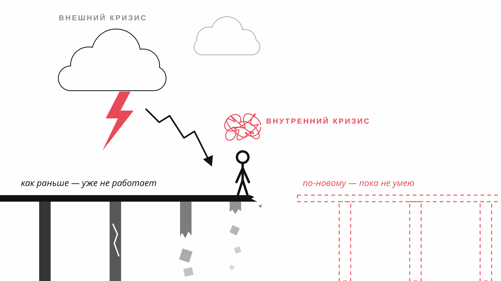
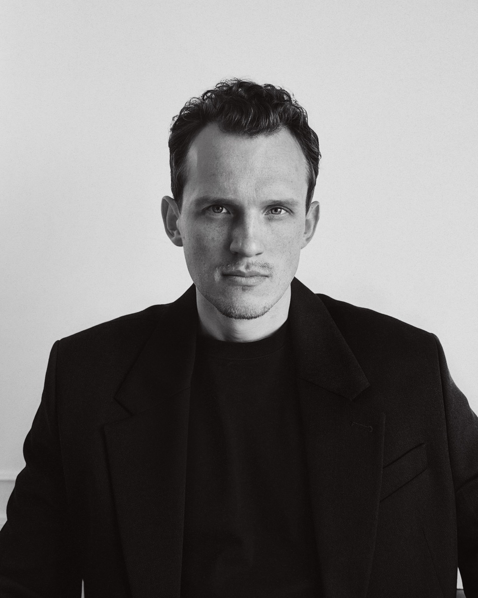
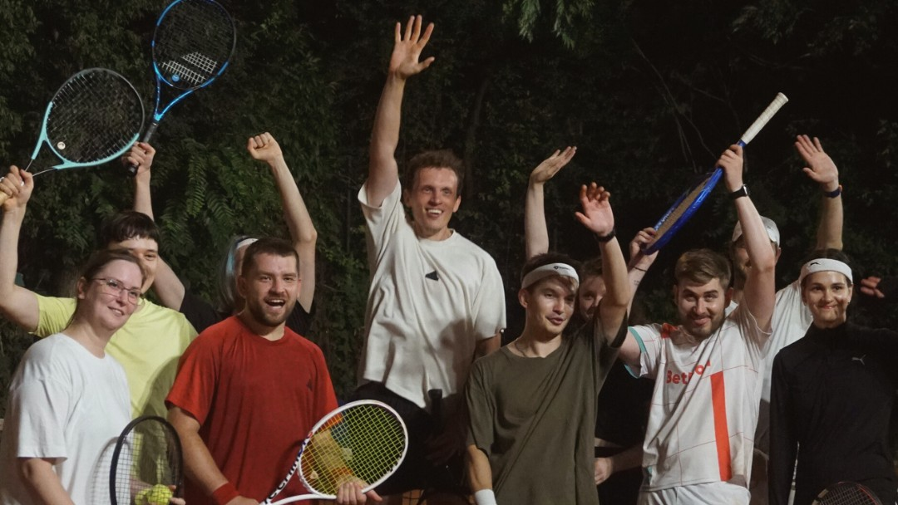
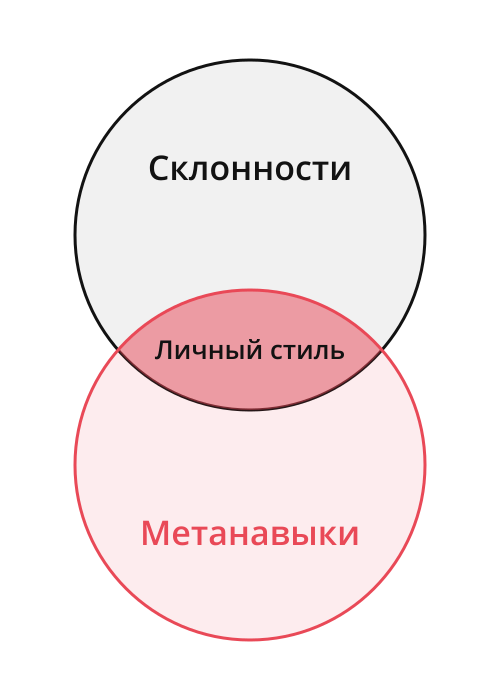
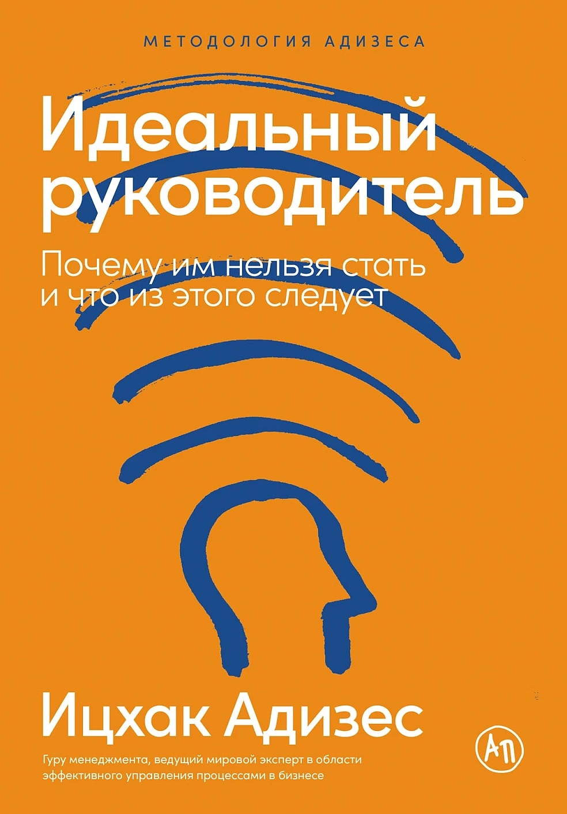
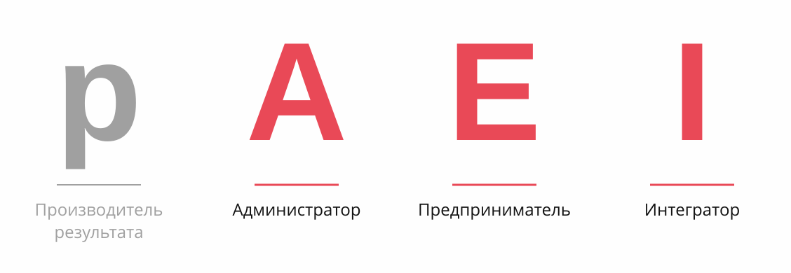
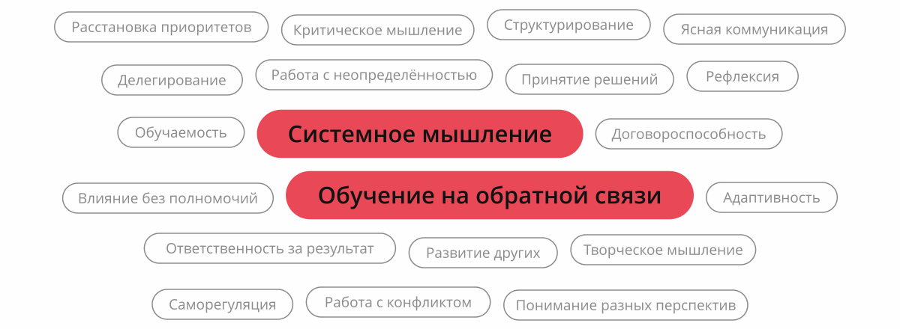
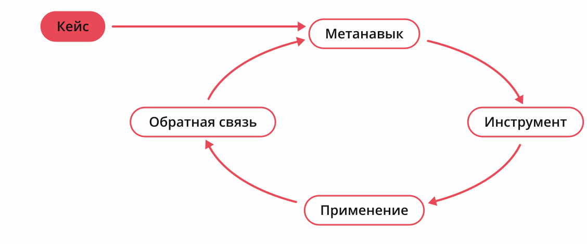
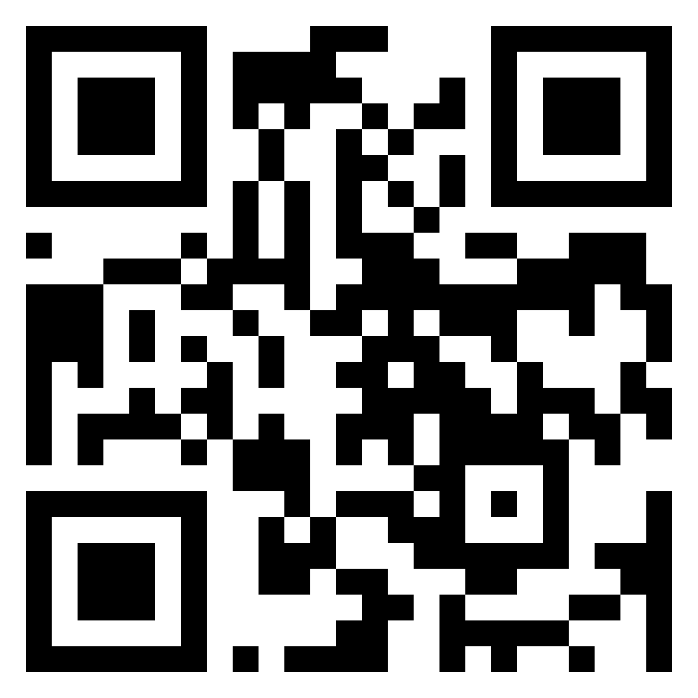

<!-- _class: lead -->
<!-- _paginate: false -->

# Востребованность менеджера в кризис: метанавыки и личный стиль управления

Владимир Семенюк

<!--
Старт. 30 минут, из них 6 на вопросы. Содержательная часть рассчитана на ≈20 минут, ≈4 минуты запаса.

Красная линия доклада:
кризисы → я тоже проходил → ушёл в офлайн-бизнес → там вообще не получалось → метанавыки и склонности помогли наладить бизнес → помогают и моим менти → и вам.
-->

---

<!-- _paginate: false -->
<!-- _footer: "" -->

<!--
≈40 сек (0:00). Сразу после титула, без представления: о себе — через пару минут, как часть истории.
Иллюстрация на весь экран.
Слева гроза и падающий график: в индустрии кризис, это пугает. Это внешний кризис.
Над человеком клубок: внешний кризис мало отличается от внутреннего, который каждый уже проживал. В основе то же состояние: старый мост держит всё хуже, его опоры рушатся, а новый пока только пунктиром.
Старые опоры исчезли, новые ещё не сформировались.
-->

---

<!-- _class: tight me -->

## Я тоже через это прошёл

- 17 лет в управлении технологиями, 
  ex‑CTO Нетологии, MBA
- Стратегический советник, ментор, предприниматель
- **Лично пережил несколько кризисов**

<!--
≈1,5 мин (1:40). Представляюсь через историю. Голосом одной фразой: «Сейчас консультирую и менторю — к этому вернусь в конце». На слайде этого нет, чтобы цитата закрывала именно период клуба.
Мой кризис — не сам клуб, а переход из наёмного руководителя в собственное дело.
Клуб сначала был романтикой: сделать место, где самому хотелось бы играть. После закрытия стартапа стал бизнесом, с которого надо жить, — динамика была перспективной.
Акцент: совсем другая отрасль, другие клиенты, другие сотрудники.
-->

---

<!-- _paginate: false -->
<!-- _footer: "" -->

<!--
Фото клуба на весь экран. Пауза 3–5 секунд, дать залу посмотреть.
-->

---

<!-- _class: tight -->

## Что пробовал переносить из IT в клуб

1. Знания отрасли
2. Профнавыки
3. Метанавыки
4. Склонности

<!--
≈1,5 мин (5:00). Чем дальше новая область, тем хуже переносится опыт. Одной фразой: продавец, ставший художником, легче продаёт картины, но не легче их пишет.
Подавать как наблюдение из своего опыта: перенос срабатывает, когда навык осознан.
Голосом про метанавыки: опоздания и жалобы — симптом системы, нужен процесс; стандарты меняю по метрикам.
Метанавык подсказал, ЧТО нужно (процесс вместо разовых реакций), профнавык — КАК (адаптированный ITSM), склонность — через какую роль (сильная A).
-->

---

## Что меня вытащило

**Склонности** — управленческие роли, которые мне естественны

**Метанавыки** — способности, которые переносятся между областями

<!--
≈40 сек (6:30). Поворот доклада. Можно искать опору в совершенно новом, но легче перенести то, что уже есть, и адаптировать.
На пересечении метанавыков и склонностей — личный стиль управления. Дальше разберу, что именно перенеслось.
-->

---

## Как понять свои склонности

1. Какие управленческие роли мне естественны, а какие я избегаю?
2. Где дополнить себя другими людьми?

<!--
≈1 мин (10:30). Дать паузу на вопросах, затем книга.
-->

---

## Мои склонности по Адизесу

<!--
≈1,5 мин (11:30). ≈1 мин на модель PAEI: один человек не силён во всех ролях.
Затем мой профиль: роль A прокачана ещё в IT. Именно она позволила быстро выстроить в клубе то, что подсказали метанавыки.
-->

---

<!-- _class: tight -->

## Метанавыков много

<!--
≈30 сек (7:10). Метанавыков много — вот двадцать, и это не полный список. Развивать все сразу не нужно.
Выделены два, которые вытащили клуб: системное мышление и обучение на обратной связи. Полная таблица всех двадцати с инструментами — в раздатке.
-->

---

## Инструмент ≠ способность

> RACI заполнена, а за решение по‑прежнему никто не отвечает

<!--
≈30 сек (10:00). Инструменты только что были на слайде, но сами по себе ничего не развивают. Нужен цикл — покажу его на клубе.
-->

---

<!-- _class: club -->

## Как это сработало в клубе

| Шаг            | Что было                                        |
| -------------- | ----------------------------------------------- |
| **Кейс**       | Опоздания и инциденты на площадке               |
| **Склонность** | Сильная **A**                                |
| **Метанавык**  | Системное мышление + обучение на обратной связи |
| **Инструмент** | ITSM, SLA, стандарты, чек‑листы, аналитика      |
| **Результат**  | Лучший клиентский сервис и удержание            |

<!--
≈3 мин (13:00). Кульминация красной линии: там, где «не получалось вообще», — лучший сервис. Кейс зал уже знает — проходим быстро, акцент на связке метанавык + склонность и на результате.
[уточнить — что изменилось в цифрах, если есть]
Честный финал: клуб закрылся — я разочаровался в бизнес‑модели. Но сервис был лучшим, и этот опыт остался со мной.
-->

---

## Цикл у моих менти

<!--
≈1,5 мин (16:00). Обобщить клуб в цикл и пройти по шагам.
Сейчас я прохожу этот цикл с менти: то, что вытащило мой клуб, помогает и им.
Кейсы разные — новая роль, новая компания, новая отрасль. Цикл тот же.
Неважно, откуда обратная связь — от человека или по метрикам. Важно, чтобы она была.
-->

---

## Первый шаг

1. Поймите свои **склонности**
2. Выберите **кейс**
3. Найдите **метанавык**
4. Подберите **инструмент**
5. **Дополните себя**, где роль вам не даётся
6. Получите **обратную связь**

<!--
≈1,5 мин (17:30). Не торопиться, дать сфотографировать слайд.
Первый пункт — отсылка к PAEI: сначала понять себя, потом действовать через свои сильные роли. Пятый — идеального руководителя нет, слабые роли закрывает команда.
-->

---

<!-- _class: lead -->

**Помните:**
## Ваша опора уже у вас есть!

<!--
≈30 сек (19:00). Замкнуть на начало: «Я прошёл кризис, ушёл в бизнес, где не получалось вообще, — и вытащило меня то, что у меня уже было. С менти работает так же. Сработает и у вас».
Финиш содержательной части ≈19:30.
-->

---

<!-- _class: lead contacts -->
<!-- _paginate: false -->

# Вопросы

**Владимир Семенюк**
*Стратегический советник, ментор, предприниматель*

- Email: [vladimir@semenyuk.pro](mailto:vladimir@semenyuk.pro)
- Web: [semenyuk.pro](https://semenyuk.pro)
- Telegram: [@vladimirsemenyuk](https://t.me/vladimirsemenyuk)

<!--
6 минут. Заготовки:
- Как выбрать, какой метанавык развивать первым?
- Как отличить свои склонности от избегания неприятных задач?
- Что делать, если в компании не принято давать обратную связь?
- Можно ли понять свои склонности без книги Адизеса?
- Если сервис был лучшим, почему клуб закрылся? [заготовить: развести операционную эффективность и бизнес-модель]
- Почему не вернулся в бизнес / почему снова IT?
-->
